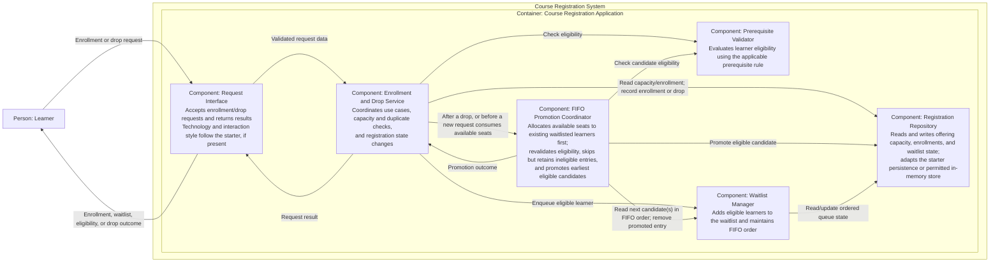

# C4 Level 3 — Course Registration Application Components

## Component diagram

## Components and responsibilities

| Component | Responsibility |
|---|---|
| Request Interface | Accepts learner enrollment and drop requests, passes them to the application workflow, and returns clear results. It is a thin interaction boundary, not a prescribed web API or frontend. |
| Enrollment and Drop Service | Implements and coordinates the enrollment and drop use cases. It checks for existing learner records and available capacity, requests prerequisite evaluation, records enrollment or waitlisting, handles unsuccessful/repeated drops, and invokes promotion after a successful drop releases a seat. |
| Prerequisite Validator | Evaluates whether a learner satisfies the applicable prerequisite rule. The rule and authoritative data source are not specified by the assignment. |
| Waitlist Manager | Maintains waitlist membership and FIFO ordering, including adding an eligible learner when the offering is full and providing candidates in order to the promotion workflow. |
| FIFO Promotion Coordinator | Allocates available seats to existing waitlisted learners before new enrollment requests. Revalidates eligibility, scans in FIFO order, skips but retains ineligible entries at their original positions, and coordinates promotion of the earliest eligible candidate(s). |
| Registration Repository | Provides the persistence boundary for offering capacity, enrollment records, and ordered waitlist state. It uses the supplied starter's data model and persistence if present, or an in-memory store only for the permitted no-starter fallback. It is not a separately deployed database. |

## Component interactions

### Successful enrollment

1. The Learner submits an enrollment request through the Request Interface.
2. The Enrollment and Drop Service checks existing enrollment/waitlist state and offering capacity through the Registration Repository. Duplicate handling must avoid duplicate records.
3. The service asks the Prerequisite Validator to evaluate eligibility.
4. If the learner is eligible, the service allocates any available seats to existing eligible waitlisted learners first.
5. The service enrolls the requester if capacity remains; otherwise, it adds them at the waitlist tail.
6. If the learner is ineligible, the service returns a clear non-enrollment result without changing enrollment state.

### Full-course waitlisting

1. The Learner submits an enrollment request through the Request Interface.
2. The Enrollment and Drop Service checks existing state and capacity through the Registration Repository and requests eligibility evaluation.
3. If the learner is eligible but the offering is full, the service asks the Waitlist Manager to enqueue the learner. The manager preserves FIFO ordering using state supplied by the Registration Repository.
4. The service returns a waitlist result through the Request Interface. The operation must not exceed course capacity or create a duplicate record.

### Dropping an enrolled learner and promotion

1. The Learner submits a drop request through the Request Interface.
2. The Enrollment and Drop Service verifies and records the drop through the Registration Repository. An invalid or repeated drop returns a clear result without corrupting state.
3. If the drop succeeds and releases a seat, the service invokes the FIFO Promotion Coordinator.
4. The coordinator asks the Waitlist Manager for candidates in FIFO order and the Prerequisite Validator to recheck eligibility.
5. It retains ineligible entries at their original positions, continues scanning, and arranges removal plus enrollment for the earliest eligible candidate(s) while seats are available.
6. If no eligible candidate remains, the drop completes and the released seat remains available.
7. The operation returns its result through the Request Interface.

### Enrollment while seats are available

Before allocating any available seat to a new eligible learner, the Enrollment and Drop Service invokes the FIFO Promotion Coordinator to allocate those seats to existing eligible waitlisted learners. The coordinator revalidates in FIFO order, skips but retains ineligible entries at their original positions, and continues until no seats or eligible waitlisted candidates remain. The new learner is then enrolled if capacity remains, or added once at the waitlist tail if full.

## Transaction and concurrency control

Enrollment, drop, queue updates, and any resulting promotion can affect the same capacity and registration state. The Enrollment and Drop Service is the use-case coordination point and should define the atomic operation boundary; the Registration Repository must participate using the starter's existing transaction or locking pattern if one exists. In particular, a successful drop and its promotion must not leave the offering over capacity or the learner simultaneously enrolled and waitlisted due to partially applied state changes. Available-seat allocation before a new request must also be coordinated atomically so the request cannot bypass an eligible existing waitlisted learner.

The assignment only requires preserving a starter's transaction or locking pattern when concurrent requests are supported; it does not prescribe a mechanism. When this diagram was prepared, no starter source or persistence implementation was available, so it did not select a lock, transaction technology, or isolation level. The current implementation coordinates operations within its single-process in-memory repository; this does not provide multi-process coordination. See the [verification report](../docs/VERIFICATION-REPORT.md) for concurrency-test evidence.

## Architectural decisions

- Keep all components inside the single Course Registration Application container from the Level 2 diagram.
- Separate request/result handling from business use cases and persistence.
- Keep prerequisite evaluation, waitlist ordering, and promotion as logical responsibilities, not separately deployed services.
- Use a Waitlist Manager for FIFO queue operations and a Promotion Coordinator for eligibility-aware promotion orchestration; do not introduce a configurable policy engine.
- Give existing eligible waitlisted learners priority over new enrollment requests when allocating available seats. Skip but retain ineligible candidates at their original queue positions; revalidate before promotion.
- Represent persistence as a repository component only. Do not add a database container or external prerequisite/identity integration not required by the assignment.
- Leave concrete implementation technology and interface style unspecified; follow the starter project if one is supplied.

## Assumptions and unresolved decisions

This is a logical component view, not a literal runtime class/deployment map. The implemented Java 21 application maps these responsibilities to the CLI, application services, and in-memory repository; see [the project README](../README.md) and [verification report](../docs/VERIFICATION-REPORT.md).

### Assumptions

- The only actor is the Learner, and the system handles one course offering, consistent with the requirements and prior context/container diagrams.
- The Request Interface is an internal application boundary for the learner interaction; it does not imply a frontend, web protocol, or API product.
- Repository-backed state includes offering capacity, enrollment membership, and waitlist order. This describes the persistence responsibility, not a particular schema.
- When the diagram was prepared, no starter source or persistence implementation was available; the diagram records the intended logical decomposition rather than the original starter's structure.

### Unresolved decisions

- The diagram does not prescribe literal class boundaries or deployment topology; the current request interface is a text CLI.
- Exact request/result shapes remain implementation-specific.
- The prerequisite rule and authoritative eligibility data. The selected design revalidates eligibility during promotion.
- The diagram does not prescribe a persistence technology or queue schema; the current implementation stores state in memory.
- Distributed transaction/locking behavior is outside the current single-process implementation and remains a future design decision.
- The capacity source/value and exact validation/error result conventions.
