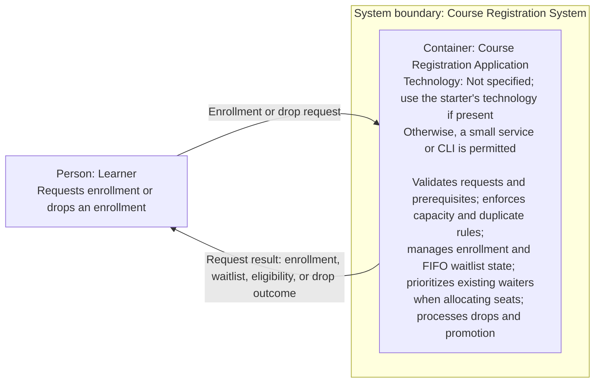

# C4 Level 2 — Container Diagram

## Container diagram

## Containers and responsibilities

| Container | Responsibility | Technology |
|---|---|---|
| Course Registration Application | Provides the enrollment and drop interaction for one offering. Validates requests and prerequisite eligibility, enforces capacity and duplicate rules, maintains enrollment and FIFO waitlist state, and allocates available seats to existing eligible waitlisted learners before new enrollment requests. After a successful drop, it promotes the earliest eligible waitlisted learner. Returns a clear request result. | No language, framework, or interface technology is specified. Use the starter project's technology and conventions if present; if no starter implementation is supplied, the assignment permits a small service or CLI. |

The application owns the registration state needed for the scoped workflow: offering capacity, enrollments, and ordered waitlist entries. When using the permitted no-starter fallback, that state may be held in memory. It is internal application state, not a separate container or external database.

## Communication

| From | To | Interaction |
|---|---|---|
| Learner | Course Registration Application | Sends an enrollment request or a request to drop an existing enrollment. |
| Course Registration Application | Learner | Returns the enrollment, waitlist, eligibility, or drop outcome. An invalid or repeated request must yield a clear result without corrupting state. |

There are no inter-container calls in this design: the diagram has one application container. Prerequisite validation, capacity checking, waitlist management, FIFO selection, and promotion are responsibilities within that container, not separately deployed services. The assignment does not prescribe a protocol or request/response format.

## Architectural decisions

- Keep the feature in one application container, consistent with the assignment's bounded slice for one course offering.
- Keep enrollment, capacity, eligibility checks, waitlist ordering, drops, and promotion in that application; do not introduce separate services.
- Do not model a database or prerequisite provider as an external container. Neither is required as an external system by the assignment.
- Keep registration state inside the application for this minimal view. If the starter has a persistence model, use it; otherwise, in-memory state is the explicitly permitted fallback.
- Preserve the starter's transaction or locking pattern if it supports concurrent requests. No additional concurrency mechanism is selected here.
- Represent the learner's interaction generically. A service interface versus CLI, and its protocol, remain unspecified rather than being selected by the diagram.

## Assumptions and unresolved technical decisions

This is a logical, technology-neutral container view. The implemented project is a Java 21 command-line application with a single-process in-memory repository; see [the project README](../README.md) and [verification report](../docs/VERIFICATION-REPORT.md) for the implemented stack and evidence.

### Assumptions

- When this diagram was prepared, the workspace contained no starter application source or persistence implementation. It therefore documented the assignment-permitted single-application fallback, rather than describing an existing starter architecture.
- In the absence of a starter implementation, the application's registration state can be held in memory. This is a permitted fallback, not a requirement to use it if a starter is supplied.
- The learner uses the application's interaction directly; no separate frontend or identity system is implied.

### Unresolved decisions

- The diagram intentionally does not prescribe a protocol or a deployment topology; the current implementation uses a local text CLI.
- The diagram is technology-neutral; the current implementation uses Java 21 and Maven.
- The prerequisite rule and the source of data used to evaluate it. The selected design revalidates eligibility at promotion.
- The assignment does not prescribe how an ineligible learner at the front is handled; the selected design skips them for that allocation, retains their original position, and continues scanning.
- This logical view does not prescribe a persistence technology. The current implementation uses single-process in-memory state that resets on exit; durable persistence is a future decision.
- The exact request-result representation and, if relevant to the starter, transaction/locking details.
