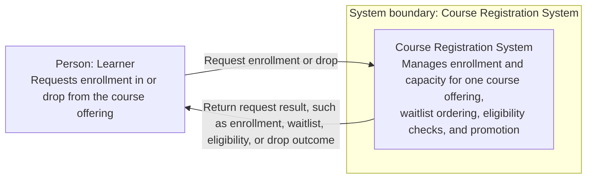

# C4 System Context — Course Registration and Waitlist Management

## Context diagram

## Actors and interactions

| Element | Description |
|---|---|
| Learner | The only user actor identified by the requirements. Requests enrollment and may drop an existing enrollment. |
| Course Registration System | The system being designed. For one offering, it validates eligibility and capacity, manages enrollment and the waitlist, and handles promotion after a seat is released. |
| Enrollment request | The learner asks to enroll. The system determines whether the learner is eligible and a seat is available, or whether the eligible learner may join the waitlist, and returns a result. |
| Drop request | The learner asks to drop an enrollment. The system returns a clear result and, on a successful drop, releases a seat and considers waitlisted learners for promotion under the documented eligibility policy. |

## System boundary

The boundary contains the Course Registration System and its one-offering enrollment, drop, capacity, eligibility, waitlist, and promotion responsibilities. The learner is outside the boundary. Eligibility checks, FIFO ordering, and promotion are shown as responsibilities of the system, not as separate external actors or integrations.

No external system is shown: the requirements do not identify one. In particular, they leave the source of prerequisite information and the persistence implementation to the starter project or later design decisions; this context diagram does not assume an external prerequisite, identity, or database service.

## Assumptions and unresolved questions

- The learner is modeled as one actor because no other user role is specified.
- The diagram groups enrollment and drop requests under a single learner-to-system relationship; the requirements do not prescribe a transport, interface, or API.
- The requirements do not define the prerequisite rule or its authoritative data source.
- The assignment does not prescribe what happens to an ineligible learner at the front of the waitlist. The selected design in [the architecture decisions](./architecture-decisions.md) skips that learner for the current allocation, retains their original position, and continues scanning; the implementation must apply this policy consistently.
- The requirements do not specify response formats or exactly which request conditions are invalid.
