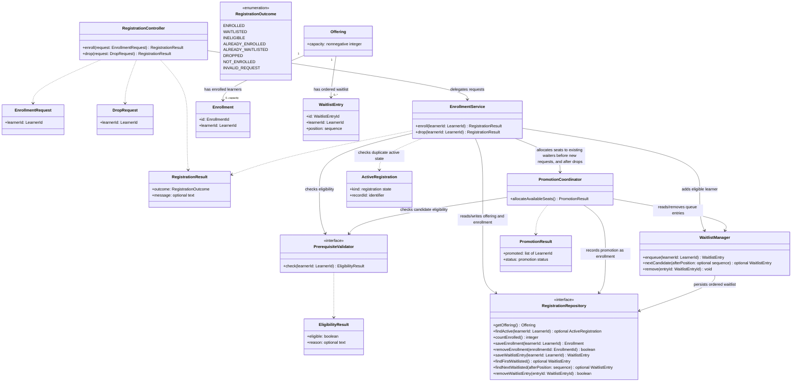
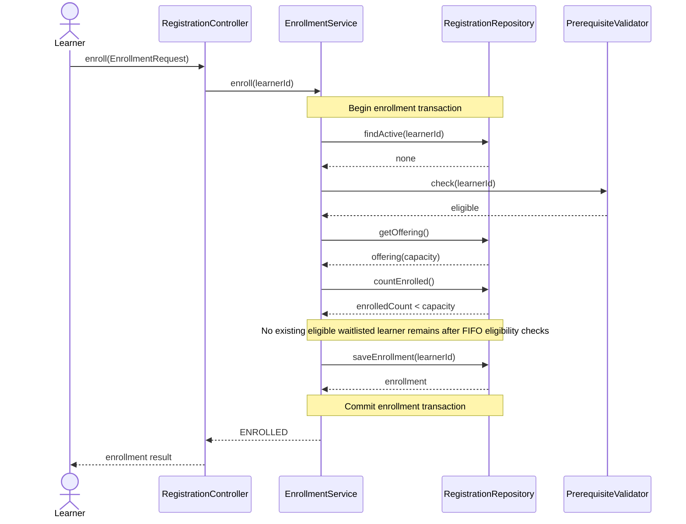
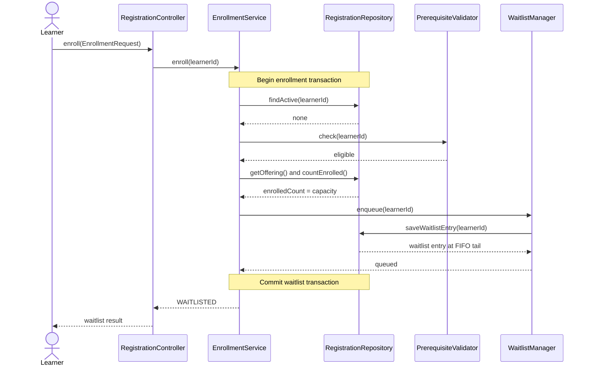
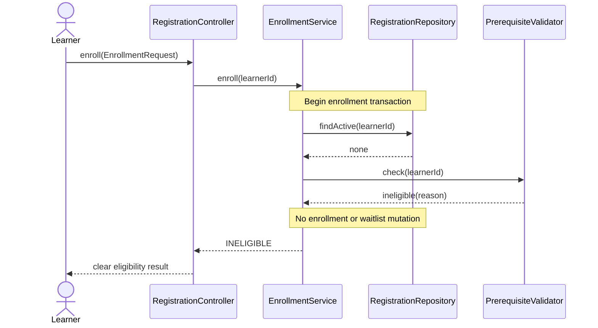

# Low-Level Design — Course Registration and Waitlist Management

## 1. Purpose and design basis

This LLD refines [the requirements](../requirement.md) and the existing [C4 context](./c4-context.md), [C4 container](./c4-container.md), and [C4 component](./c4-component.md) diagrams into logical classes, data constraints, interactions, and transaction boundaries.

When this LLD was prepared, the workspace contained assignment/design documents but no application source, starter data model, persistence implementation, or declared technology stack. The names and signatures below are proposed, technology-neutral design choices, not a literal description of the implementation. The project has since been implemented in Java 21 with a CLI and in-memory repository. See [the project README](../README.md) and [verification report](../docs/VERIFICATION-REPORT.md) for the current implementation and evidence. Signatures in this document remain language-neutral.

The system supports one course offering only. No frontend, identity integration, external prerequisite service, database technology, or additional offering/catalog feature is assumed.

## 2. Logical class diagram



`findFirstWaitlisted`/`findNextWaitlisted` express the need to inspect entries in queue order; an implementation may use one repository operation that returns ordered candidates. `RegistrationOutcome` and the response fields are illustrative result categories, not a prescribed public API. The starter may require different types or status names. Duplicate outcomes distinguish an already-enrolled learner from an already-waitlisted learner where the starter's result conventions permit.

## 3. Class and interface responsibilities

| Class/interface | Responsibility |
|---|---|
| `RegistrationController` | Thin request boundary. Validates basic request shape, calls the use-case service, and maps its result to the starter's interaction format. In a CLI starter, this role can be the existing command handler rather than a web controller. It contains no capacity or promotion rules. |
| `EnrollmentRequest`, `DropRequest` | Carry the learner identifier for the requested operation. The one-offering scope means an offering identifier is not required in the proposed DTOs. If the starter's interface requires one, accept and validate it against the one configured offering; do not broaden scope to a catalog. |
| `RegistrationResult`, `RegistrationOutcome` | Communicate clear success and expected business outcomes, including ineligible, already enrolled, already waitlisted, waitlisted, and not enrolled. Exact result shape and wording follow the starter. |
| `EnrollmentService` | Coordinates enrollment and drop use cases: duplicate check, eligibility check, capacity decision, state changes, and promotion invocation. Before allocating an available seat to a new request, it gives eligible existing waitlisted learners priority. Owns the logical transaction boundary for each state-changing use case. |
| `PrerequisiteValidator` | Evaluates eligibility for a learner against the applicable prerequisite rule. Its data source is not specified; it must use the starter's supplied model if present and must not imply a new external integration. |
| `EligibilityResult` | Represents an eligibility decision and, if useful, a concise reason for the service/result mapping. It does not expose sensitive or unnecessary learner data. |
| `WaitlistManager` | Adds eligible learners to the waitlist and provides/removes entries in FIFO order. It does not independently decide prerequisite rules or promotion policy. |
| `PromotionCoordinator` | Allocates available seats to existing waitlisted candidates in FIFO order, revalidating eligibility. It skips but retains ineligible entries at their original positions and promotes the earliest eligible candidate(s) until no seat or eligible candidate remains. |
| `RegistrationRepository` | Persistence boundary for the one offering's capacity, active enrollment, and ordered waitlist state. Adapt the starter's repository/model if available; otherwise it may be backed by the permitted in-memory store. It is not a mandated database or separately deployed service. |
| `Offering` | Holds the capacity for the single offering. It does not model a course catalog, term, or multiple offerings. |
| `Enrollment` | Represents a learner's active seat in the offering. |
| `WaitlistEntry` | Represents one active queue position for a learner. Its position must preserve FIFO order; the stored representation is implementation-dependent. |
| `ActiveRegistration` | A repository lookup result that lets the service detect whether the learner already has an active enrollment or waitlist entry. It may be represented using the starter's existing model rather than implemented as a separate persisted entity. |
| `PromotionResult` | Returns an internal outcome to the enrollment/drop workflow, such as the promoted learners, whether a candidate was eligible, and whether seats remain available. Exact fields may follow the starter's conventions. |

No separate `Learner` entity is introduced: the assignment does not require learner account management or identity storage. `LearnerId` is the identifier available to the registration workflow.

## 4. Important method signatures

The following language-neutral signatures show responsibilities, not a required type system or API.

### Request boundary

| Method | Responsibility |
|---|---|
| `RegistrationController.enroll(request: EnrollmentRequest): RegistrationResult` | Pass the learner's enrollment intent to `EnrollmentService` and return a clear outcome. |
| `RegistrationController.drop(request: DropRequest): RegistrationResult` | Pass the learner's drop intent to `EnrollmentService` and return a clear outcome. |

### Use-case service

| Method | Responsibility |
|---|---|
| `EnrollmentService.enroll(learnerId: LearnerId): RegistrationResult` | Within one atomic enrollment operation, return a clear duplicate outcome if already enrolled or waitlisted, validate prerequisites, allocate any available seats to existing eligible waitlisted learners first, then enroll the requester if a seat remains or enqueue them at the FIFO tail if full. Ineligible requesters are neither enrolled nor waitlisted. |
| `EnrollmentService.drop(learnerId: LearnerId): RegistrationResult` | Within the starter-supported atomic boundary, return a clear not-enrolled result without mutation if no enrollment exists. Otherwise remove the enrollment and invoke available-seat allocation; if no eligible waitlisted learner is found, complete the drop and leave the seat available. |

### Eligibility and waitlist

| Method | Responsibility |
|---|---|
| `PrerequisiteValidator.check(learnerId: LearnerId): EligibilityResult` | Evaluate the applicable prerequisite rule. Call this for initial enrollment and again immediately before promotion; the eligibility source and rule remain unresolved. |
| `WaitlistManager.enqueue(learnerId: LearnerId): WaitlistEntry` | Add one eligible learner at the end of the FIFO queue. The operation must not produce duplicate active registration. |
| `WaitlistManager.nextCandidate(afterPosition: optional sequence): optional WaitlistEntry` | Return the next candidate after the supplied cursor in FIFO order. A skipped ineligible entry remains stored at its original position. |
| `WaitlistManager.remove(entryId: WaitlistEntryId): void` | Remove an entry only as part of its successful promotion. |
| `PromotionCoordinator.allocateAvailableSeats(): PromotionResult` | While seats are available, scan waitlisted candidates in FIFO order, revalidate eligibility, skip but retain ineligible candidates, and promote eligible candidates in FIFO order. Stop when no seat or no eligible candidate remains. |

### Persistence boundary

| Method | Responsibility |
|---|---|
| `RegistrationRepository.getOffering(): Offering` | Return the configured offering and capacity; missing/invalid configuration must not be disguised as a successful result. |
| `RegistrationRepository.findActive(learnerId: LearnerId): optional ActiveRegistration` | Detect existing enrollment or waitlist membership for duplicate prevention. |
| `RegistrationRepository.countEnrolled(): integer` | Read current occupied seats for capacity validation. |
| `RegistrationRepository.saveEnrollment(learnerId: LearnerId): Enrollment` | Record an active enrollment within the caller's transaction. |
| `RegistrationRepository.removeEnrollment(enrollmentId: EnrollmentId): boolean` | Remove the active enrollment and release a seat; `false` indicates no matching record. |
| `RegistrationRepository.saveWaitlistEntry(learnerId: LearnerId): WaitlistEntry` | Persist an entry at the tail of the FIFO queue. |
| `RegistrationRepository.findFirstWaitlisted(): optional WaitlistEntry` and `findNextWaitlisted(afterPosition: sequence): optional WaitlistEntry` | Read candidates in deterministic FIFO order. These may be consolidated into one ordered-candidate query/operation. |
| `RegistrationRepository.removeWaitlistEntry(entryId: WaitlistEntryId): boolean` | Remove a queue entry as part of promotion or the selected ineligible-entry policy. |

## 5. Entity relationships and data constraints

### Logical relationships

- One configured `Offering` has zero or more active `Enrollment` records, up to its capacity.
- One configured `Offering` has zero or more `WaitlistEntry` records ordered FIFO.
- Each active registration is associated with one `LearnerId` and is either enrolled or waitlisted, never both.
- Capacity is an offering attribute, not a count maintained independently of enrollment records.
- `WaitlistEntry.position` is a logical ordering key. It may be represented by a sequence number, creation order, or the starter's equivalent; the assignment does not specify a storage representation.

### Required invariants

1. `capacity >= 0`.
2. `0 <= enrolledCount <= capacity` after every completed operation.
3. At most one active registration exists for a learner in the one offering.
4. An active learner cannot simultaneously have an `Enrollment` and a `WaitlistEntry`.
5. Only an eligible learner may be enrolled or added to the waitlist.
6. A promotion removes the learner from the waitlist and records enrollment as one consistent state transition.
7. Queue ordering is deterministic FIFO; enqueueing a new learner places them behind existing entries.
8. A failed/invalid request or repeated drop does not create, remove, or duplicate unrelated records.
9. When allocating available seats, existing eligible waitlisted learners have priority over new enrollment requests.

The unique-active-registration rule must be enforced within the state-change transaction and, where supported by the starter's storage, by an appropriate uniqueness constraint or equivalent guard. Exact schema/index syntax is persistence-specific and not specified here.

### Focused acceptance scenarios for available-seat priority

These scenarios operationalize the selected design assumption in [ADR-06](./architecture-decisions.md#adr-06--eligibility-and-waitlist-promotion-policy); they do not amend FR-02 or AC-01. For those criteria, capacity available to a new learner is capacity remaining after existing eligible waitlisted learners have been considered.

| ID | Given | When | Then |
|---|---|---|---|
| LLD-AC-01 | One seat is available, an eligible learner is already waitlisted, and a different eligible learner requests enrollment. | The request is processed. | Revalidate and promote the existing waiter first. If that consumes the seat, return a clear waitlisted outcome for the requester; enrollment never exceeds capacity. |
| LLD-AC-02 | One seat is available; the FIFO queue contains an ineligible learner followed by an eligible learner, and a new eligible learner requests enrollment. | The request is processed. | Skip the ineligible learner without moving or removing their entry, promote the next eligible waiter, and place the requester in the waitlist if the seat is consumed. |
| LLD-AC-03 | A seat is available and all existing waitlisted learners are ineligible. | An eligible new learner requests enrollment. | Revalidate and retain each ineligible entry at its original position; because no eligible waiter takes the seat, enroll the requester. |
| LLD-AC-04 | Capacity is `C`, fewer than `C` seats are occupied, and concurrent eligible requests include duplicate requests for the same learner. | Requests contend for enrollment and available-seat allocation. | Atomic allocation never produces more than `C` enrollments, never creates more than one active registration per learner, and does not let a new request bypass an eligible existing waiter. |

## 6. Sequence diagrams

### Successful enrollment

This flow assumes capacity remains and no existing eligible waitlisted learner has priority for an available seat (the queue is empty, or all candidates were revalidated and found ineligible). Under the selected design assumption in ADR-06, FR-02/AC-01's “capacity remains” condition is assessed after existing eligible waitlisted learners have been considered, as illustrated in the following priority flow.



### Available seat with existing waitlist

```mermaid
sequenceDiagram
    actor Learner
    participant Boundary as RegistrationController
    participant Service as EnrollmentService
    participant Repo as RegistrationRepository
    participant Promotion as PromotionCoordinator
    participant Queue as WaitlistManager
    participant Prereq as PrerequisiteValidator

    Learner->>Boundary: enroll(EnrollmentRequest)
    Boundary->>Service: enroll(learnerId)
    Note over Service,Repo: Begin atomic enrollment/allocation operation
    Service->>Repo: findActive(learnerId)
    Repo-->>Service: none
    Service->>Prereq: check(learnerId)
    Prereq-->>Service: eligible
    Service->>Repo: getOffering() and countEnrolled()
    Repo-->>Service: available seat(s)
    Service->>Promotion: allocateAvailableSeats()
    loop While seats are available and candidates remain
        Promotion->>Queue: nextCandidate(afterPosition)
        Queue->>Repo: read next candidate in FIFO order
        Repo-->>Queue: candidate or none
        Queue-->>Promotion: candidate or none
        alt Candidate exists
            Promotion->>Prereq: check(candidate.learnerId)
            Prereq-->>Promotion: eligibility result
            alt Eligible
                Promotion->>Queue: remove(candidate.entryId)
                Queue->>Repo: removeWaitlistEntry(entryId)
                Promotion->>Repo: saveEnrollment(candidate.learnerId)
            else Ineligible
                Note over Promotion,Queue: Retain at original position; advance scan cursor
            end
        else Queue exhausted
            Note over Promotion,Queue: No eligible waiter found; leave remaining seat for requester
        end
    end
    Promotion-->>Service: seats allocated to eligible existing waiters first
    Service->>Repo: countEnrolled()
    Repo-->>Service: capacity reached or seat remains
    alt Seat remains
        Service->>Repo: saveEnrollment(learnerId)
        Repo-->>Service: enrollment
        Service-->>Boundary: ENROLLED
    else No seat remains
        Service->>Queue: enqueue(learnerId)
        Queue->>Repo: saveWaitlistEntry(learnerId) at FIFO tail
        Service-->>Boundary: WAITLISTED
    end
    Note over Service,Repo: Commit atomic operation
    Boundary-->>Learner: enrollment or waitlist result
```

### Enrollment when the course is full



### Drop and FIFO promotion

```mermaid
sequenceDiagram
    actor Learner
    participant Boundary as RegistrationController
    participant Service as EnrollmentService
    participant Repo as RegistrationRepository
    participant Promotion as PromotionCoordinator
    participant Queue as WaitlistManager
    participant Prereq as PrerequisiteValidator

    Learner->>Boundary: drop(DropRequest)
    Boundary->>Service: drop(learnerId)
    Note over Service,Repo: Begin drop and promotion transaction boundary
    Service->>Repo: findActive(learnerId)
    Repo-->>Service: active enrollment
    Service->>Repo: removeEnrollment(enrollmentId)
    Repo-->>Service: removed; seat released
    Service->>Promotion: allocateAvailableSeats()
    loop While a seat is available and candidates remain
        Promotion->>Queue: nextCandidate(afterPosition)
        Queue->>Repo: read next entry after cursor in FIFO order
        Repo-->>Queue: candidate or none
        Queue-->>Promotion: candidate or none
        alt Candidate exists
            Promotion->>Prereq: check(candidate.learnerId)
            Prereq-->>Promotion: eligibility result
            alt Candidate is eligible
                Promotion->>Queue: remove(candidate.entryId)
                Queue->>Repo: removeWaitlistEntry(entryId)
                Repo-->>Queue: removed
                Promotion->>Repo: saveEnrollment(candidate.learnerId)
                Repo-->>Promotion: enrollment
            else Candidate is ineligible
                Note over Promotion,Queue: Retain entry at original position and advance scan cursor
            end
        else Queue is empty
            Note over Promotion,Repo: No eligible candidate; successful drop commits and seat remains available
        end
    end
    Promotion-->>Service: promotion result
    Note over Service,Repo: Commit successful drop and any promotion consistently
    Service-->>Boundary: drop and promotion outcome
    Boundary-->>Learner: clear drop result
```

The sequence shows the selected successful-drop path. Make drop and promotion atomic where the starter supports it. If the starter cannot span the full workflow, preserve its supported atomic operations: the drop may complete with a seat open if promotion cannot complete, but never remove a waitlist entry without successfully recording its enrollment. Surface technical failures using the starter's conventions; do not report an uncommitted promotion.

### Prerequisite validation failure



The prerequisite failure sequence describes an enrollment request. Promotion uses the same validator and must not enroll an ineligible waitlisted learner; it skips that candidate for the current allocation, retains the original entry and position, and continues scanning.

## 7. Transaction and concurrency decisions

### Logical transaction boundaries

- **Enrollment and available-seat priority:** Duplicate lookup, eligibility check, allocation of available seats to existing eligible waitlisted learners, and the new learner's enrollment or waitlist insertion form one atomic state-changing operation. Existing eligible waiters are served before the incoming learner. A concurrent request must not overbook capacity, bypass the existing queue, or create duplicate active registration.
- **Drop and promotion:** Removing the enrollment and allocating the released seat to the earliest eligible waitlisted learner(s) form one logical workflow. Make the workflow atomic where the starter supports it. If the starter cannot span the complete workflow, keep each persisted transition consistent: a completed drop can leave an available seat if promotion fails, but a queue entry must not be removed unless its enrollment is successfully recorded.
- **Read-only rejection:** Invalid requests and prerequisite failures make no registration-state mutation. A duplicate enrollment or waitlist request returns a clear outcome without mutation. A repeated/unknown drop returns a clear non-success outcome without releasing another seat.

### Concurrency

Use the starter's existing transaction or locking pattern if it supports concurrent requests. Capacity check plus insertion, duplicate check plus insertion, available-seat priority allocation plus the incoming request decision, and FIFO candidate selection plus promotion must be protected by that pattern sufficiently to maintain the invariants above. The complete logical operation is serialized as needed so a new request cannot claim a seat ahead of an eligible existing waitlisted learner.

No new transaction manager, distributed lock, database, or concurrency framework is proposed. If the no-starter in-memory fallback is used, protect the complete state transition using the simplest synchronization appropriate to its execution model. The exact mechanism is implementation-specific and should be tested where practical; no particular technology is mandated.

## 8. Exception and error handling

Expected business outcomes should be returned as clear `RegistrationResult` values (or the starter's equivalent), not treated as unexpected infrastructure exceptions.

| Scenario | Expected handling |
|---|---|
| Missing or malformed learner identifier / invalid request data | Reject at the request boundary with a clear invalid-request result. Do not mutate state. Exact validation rules and response representation follow the starter or require a later decision. |
| Learner already enrolled or waitlisted | Return a clear duplicate outcome, distinguishing already enrolled from already waitlisted where supported; do not create a second active record. |
| Prerequisite not satisfied | Return an ineligible outcome; do not enroll or waitlist on the enrollment path. On promotion, skip the learner for this allocation, retain the waitlist entry at its original position, and continue scanning. |
| Offering has no available seat | This is not an error for an eligible learner; add them once to the FIFO waitlist and return the waitlist outcome. |
| Available seat and existing eligible waitlist | As selected in ADR-06, allocate available seats to existing eligible waitlisted learners in FIFO order before considering the new request. If no eligible waiter is found or seats remain afterward, the new eligible learner may enroll; otherwise, enqueue them at the tail and return WAITLISTED. |
| Drop target is not enrolled / request repeated | Return a clear not-enrolled outcome, indicating there was no active enrollment to drop; do not change capacity or queue state. |
| No eligible candidate is promoted after a drop | Complete the drop, retain all waitlist entries and positions, leave the seat available, and return a clear drop outcome indicating no promotion if the starter's result format supports it. |
| Offering configuration/capacity is missing or invalid | Surface a configuration/domain failure through the starter's standard error path. Do not substitute a success-shaped default capacity. |
| Repository, transaction, or persistence failure | Roll back the active transaction where supported and surface the failure through the starter's standard error/logging mechanism. If the full drop/promotion cannot be one transaction, do not persist a queue removal without the corresponding enrollment; a completed drop may leave an available seat. Do not report a promotion that failed to persist. |
| Concurrent conflict or uniqueness violation | Follow the starter's transaction/locking and conflict-handling conventions; re-read or return a clear conflict outcome as appropriate. Do not silently suppress the conflict or leave partial state. |

The assignment does not define exception classes, HTTP status codes, CLI exit codes, logging framework, or whether duplicate requests are represented as errors versus normal outcomes.

## 9. Assumptions and unresolved decisions

### Assumptions and proposed design choices

- **One offering:** The diagram and method signatures omit a catalog and treat the configured offering as the sole registration scope. If starter interfaces require an offering identifier, validate it against this bounded scope.
- **Technology-neutral names:** Class and method names are logical proposals. Existing starter types and naming conventions take precedence.
- **Registration identity:** A `LearnerId` is supplied by the interaction boundary; this design does not add authentication, identity lookup, or learner-profile storage.
- **Single persistence boundary:** One `RegistrationRepository` covers capacity, enrollment, and waitlist state, consistent with the C4 component view. It may adapt an existing starter model rather than require a new repository implementation.
- **Eligibility before waitlisting and promotion:** Check eligibility before adding a new learner to the waitlist and revalidate each candidate before promotion.
- **Existing-waitlist priority:** Before an incoming eligible learner consumes an available seat, allocate available seats to existing eligible waitlisted learners in FIFO order. If no eligible waiter exists or seats remain afterward, process the new learner against remaining capacity.
- **FR-02 / AC-01 interpretation:** “Capacity remains” for a new enrollment means capacity remaining after existing eligible waitlisted learners have been considered. This is the selected allocation-order assumption in ADR-06; the original requirement and acceptance criterion are unchanged.
- **No eligible candidate:** A successful drop completes, the skipped ineligible entries remain in their original positions, and the released seat remains available.
- **Logical atomicity:** Related state changes share the starter-supported transaction/locking boundary where possible. If full workflow atomicity is unsupported, persist only internally consistent transitions as described above.

### Unresolved business and production decisions

1. What prerequisite rule applies and where authoritative eligibility data comes from; behavior if that data is unavailable.
2. The demo uses capacity `2`; production capacity source/configuration and operational ownership are not defined by the assignment.
3. This logical design does not prescribe a production database or deployment topology. The implemented fallback is a Java 21 CLI backed by a single-process in-memory repository; state is not durable or shared across processes.
4. The implemented interaction is a text CLI. A future network service/API is neither required nor specified.
5. The current repository serializes state transitions and stages transactions in memory. Distributed transaction/locking behavior is not implemented or specified.
6. Exact real-world prerequisite data, its authority, and its behavior when unavailable remain unresolved; the current eligible-ID fixture is demo data only.

## 10. Validation against requirements and C4 diagrams

- **Requirements:** Covers one-offering enrollment, prerequisite validation, full-course waitlisting, duplicate prevention, dropping, FIFO promotion, invalid/repeated requests, state invariants, and conditional transaction/concurrency expectations. The selected retain-and-skip policy resolves the assignment's queue-head ambiguity. LLD-AC-01 through LLD-AC-04 verify available-seat priority, retained ineligible positions, newcomer enrollment when no eligible waiter exists, and concurrent capacity/duplicate invariants.
- **C4 context:** Retains the Learner as the sole actor and Course Registration System as the system boundary; no external system is added.
- **C4 container:** Keeps one Course Registration Application; the logical diagram remains technology-neutral while the implementation is a Java CLI with in-memory persistence.
- **C4 components:** Refines Request Interface to `RegistrationController`, enrollment/drop orchestration to `EnrollmentService`, and preserves `PrerequisiteValidator`, `WaitlistManager`, `PromotionCoordinator`, and `RegistrationRepository` responsibilities.
- **Design versus implementation:** This document specifies logical design rather than source code. The implemented stack and executed evidence are summarized in the [README](../README.md) and [verification report](../docs/VERIFICATION-REPORT.md).

The selected decisions align with the C4 boundaries and components. Class names, DTO/result shapes, and logical transaction boundaries remain technology-neutral proposals. The authoritative prerequisite rule/data and production capacity source remain unresolved.

**FR-02 / AC-01 consistency:** The original requirements remain unchanged. The selected ADR-06 assumption defines allocation order: existing eligible waitlisted learners are considered first, and an eligible new learner is enrolled if capacity remains afterward. LLD-AC-01 through LLD-AC-04 make this assumption independently verifiable. This interprets “capacity remains” for allocation; it does not change the stated eligibility or capacity conditions.
